<a href="https://howsuyash.github.io/">howsuyash.github.io</a> · <a href="https://www.linkedin.com/in/howsuyash/">LinkedIn</a> · <a href="mailto:suyashshukla0702@gmail.com">suyashshukla0702@gmail.com</a> · <a href="https://quenaire.com">quenaire.com</a>

