  

<h1 align="center">Hey there, I'm Suyash 👋</h1>

  

  
  
  

<table>
<tr>
<td width="68%" valign="top">

- 🎓 Third-year **B.Tech CSE (Data Science)** at ABES Engineering College — class of 2028
- 🛡️ Built **[Quenaire](https://github.com/HowSuyash/Quenaire)**, an AI SaaS that answers security questionnaires from a company's own docs — live at [quenaire.com](https://quenaire.com)
- 🗣️ **[Diplo](https://github.com/HowSuyash/Diplo)** — a Hindi voice agent that runs your phone — finished **top 5 at HackIIITD 2026**
- 🔮 **[AttackForecast](https://github.com/HowSuyash/AttackForecast)** — a world model forecasting network attacks, built for **SIH 2026**
- 💼 Two internships so far — **IBM** and **Tryhosting**
- 🌱 Currently into RAG, agents, and WebXR on Meta Quest
- ✨ Open to internships · India — remote

</td>
<td width="32%" align="center" valign="middle">
  
</td>
</tr>
</table>

   
  

<table>
<tr>
<td width="50%" valign="top">

### 🛡️ [Quenaire](https://github.com/HowSuyash/Quenaire)
AI SaaS that drafts security & compliance questionnaire answers with RAG over pgvector — every answer cites its source, gaps get flagged, not guessed.

`Spring Boot` `React` `PostgreSQL` `pgvector`

</td>
<td width="50%" valign="top">

### 🗣️ [Diplo](https://github.com/HowSuyash/Diplo)
Voice agent that runs your Android phone and the web in Hindi, Hinglish or English — and asks *"haan?"* before anything risky.

`Kotlin` `Jetpack Compose` `FastAPI` `On-device LLM`

</td>
</tr>
<tr>
<td width="50%" valign="top">

### 🔮 [AttackForecast](https://github.com/HowSuyash/AttackForecast)
World model that forecasts the next MITRE ATT&CK stage from network telemetry and explains every prediction. Runs offline on a CPU.

`PyTorch` `FastAPI` `Scapy` `SIH 2026`

</td>
<td width="50%" valign="top">

### 🖐️ [Shadow Play](https://github.com/HowSuyash/shadow-play)
Hands-only WebXR shadow-puppet game for Meta Quest — no controllers, just your hands.

`TypeScript` `WebXR` `Three.js` `Meta Quest`

</td>
</tr>
<tr>
<td width="50%" valign="top">

### 📜 [PolicyLens](https://github.com/HowSuyash/PolicyLens)
Ask policy PDFs questions in English, Hindi or Hinglish — answers cite and highlight the exact clause. Fully local RAG.

`Python` `RAG` `Local LLM`

</td>
<td width="50%" valign="top">

### 🛠️ [fixpoint](https://github.com/HowSuyash/fixpoint)
Bug report in, failing test, green suite — a test-first bug-fixing agent on NVIDIA Nemotron.

`Python` `Agents` `Nemotron`

</td>
</tr>
</table>

  

  

  <picture>
    <source media="(prefers-color-scheme: dark)" srcset="https://raw.githubusercontent.com/HowSuyash/HowSuyash/output/github-snake-dark.svg"/>
    <source media="(prefers-color-scheme: light)" srcset="https://raw.githubusercontent.com/HowSuyash/HowSuyash/output/github-snake.svg"/>
    
  </picture>

  
  
  
  

